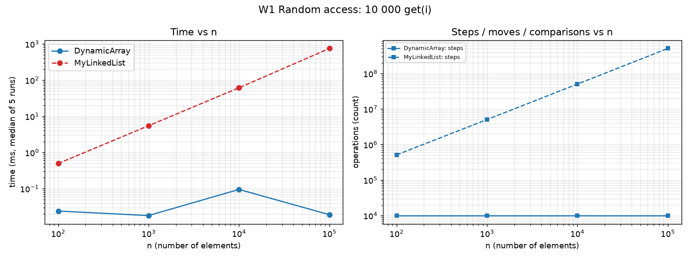
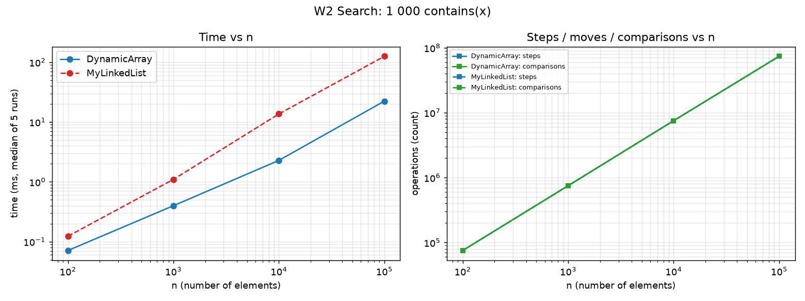
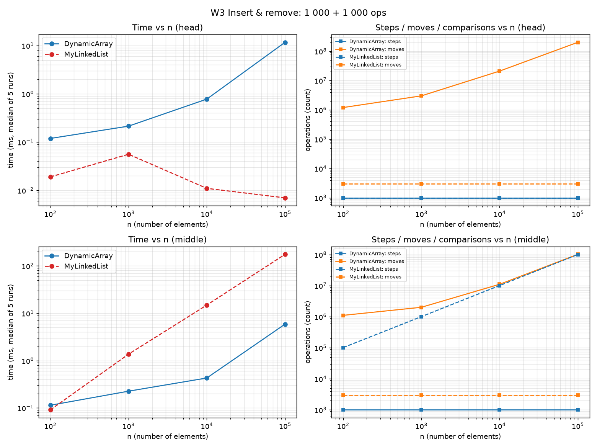
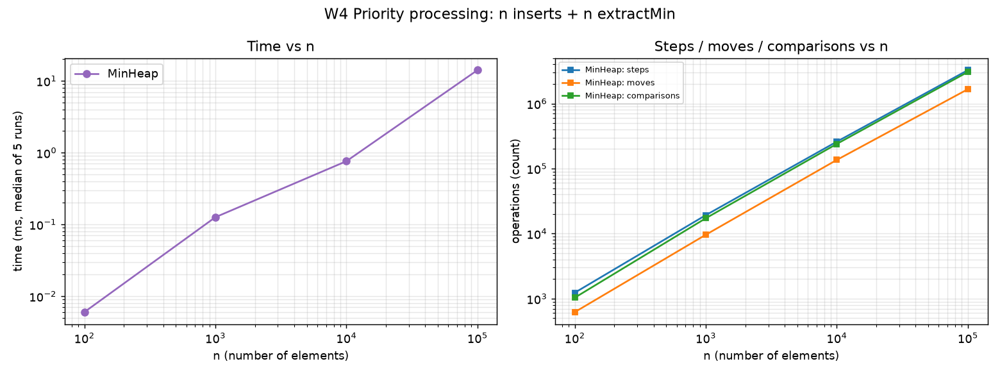
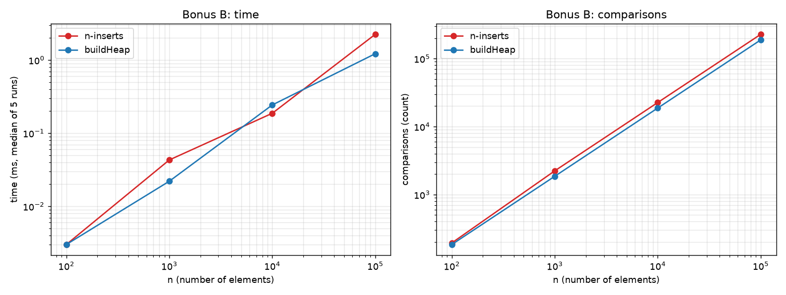

# Assignment 2 - Data Structures: DynamicArray, MyLinkedList, MinHeap

**Student:** Mussa Madi, SE-2509  
**Course:** Design and Analysis of Algorithms

All structures store primitive `int` values. Operation counters are incremented inside the data-structure methods. Benchmarks use `new Random(42)`, 3 discarded warm-up runs, and the median of 5 measured runs for sizes `n = 100, 1 000, 10 000, 100 000`. Raw benchmark data is stored in `results/results.csv`.

## 1. Complexity Table

Notation: `n` is the current number of stored elements. Average-case statements for indexed array/list operations assume a uniformly random valid index. Heap average-case comments assume random input keys.

| Structure | Operation | Best | Average | Worst | Auxiliary Space | Justification |
|---|---|---|---|---|---|---|
| DynamicArray | `get(i)` | Θ(1) | Θ(1) | Θ(1) | Θ(1) | One indexed array read. |
| DynamicArray | `add(x)` | Θ(1) | Θ(1) amortized | Θ(n) for one resizing call | Θ(1) normally, Θ(n) transient during resize | Appends at `a[size]`; when full, capacity doubles and existing elements are copied. |
| DynamicArray | `add(i, x)` | Θ(1) when `i = size` | Θ(n) | Θ(n) when `i = 0` | Θ(1), excluding a possible resize copy | Shifts `size - i` elements to the right. |
| DynamicArray | `remove(i)` | Θ(1) when `i = size - 1` | Θ(n) | Θ(n) when `i = 0` | Θ(1) | Shifts `size - i - 1` elements to the left. |
| DynamicArray | `contains(x)` | Θ(1) | Θ(n) | Θ(n) | Θ(1) | Linear scan; an absent value requires checking all `n` elements. |
| MyLinkedList | `get(i)` | Θ(1) when `i = 0` | Θ(n) | Θ(n) when `i = n - 1` | Θ(1) | Traverses nodes from the head until index `i`. |
| MyLinkedList | `add(x)` | Θ(1) | Θ(1) | Θ(1) | Θ(1) | A tail pointer allows constant-time append with a small number of link updates. |
| MyLinkedList | `add(i, x)` | Θ(1) when `i = 0` or `i = n` | Θ(n) | Θ(n) | Θ(1) | Traverses to the insertion position and then updates links. |
| MyLinkedList | `remove(i)` | Θ(1) when `i = 0` | Θ(n) | Θ(n) | Θ(1) | Traverses to the predecessor of the removed node, then updates links. |
| MyLinkedList | `contains(x)` | Θ(1) | Θ(n) | Θ(n) | Θ(1) | Linear scan through list nodes. |
| MinHeap | `peekMin()` | Θ(1) | Θ(1) | Θ(1) | Θ(1) | Reads the root at `a[0]`. |
| MinHeap | `insert(x)` | Θ(1) | Θ(1) expected for random keys | Θ(log n) | Θ(1) | Bubble-up moves through at most the heap height. |
| MinHeap | `extractMin()` | Θ(1) in a case requiring no sinking | Θ(log n) | Θ(log n) | Θ(1) | The last value is moved to the root and may bubble down through the heap height. |
| MinHeap | `buildHeap(int[])` (bonus) | Θ(n) | Θ(n) | Θ(n) | Θ(1) beyond the heap array | Floyd's bottom-up construction performs a total linear amount of sift-down work. |

The structures themselves use Θ(n) memory: DynamicArray and MinHeap use primitive arrays, while MyLinkedList stores one node object per element.

## 2. Loop Invariant Proofs

### 2.1 `DynamicArray.contains(x)`

```java
for (int i = 0; i < size; i++) {
    if (a[i] == x) {
        return true;
    }
}
return false;
```

**Invariant:** Before every iteration with index `i`, the value `x` does not occur in positions `0` through `i - 1`.

**Initialization:** Before the first iteration, `i = 0`. No elements have been checked, so the range before index `0` is empty and the invariant is true.

**Maintenance:** Assume the invariant is true before iteration `i`. If `a[i] == x`, the method returns `true`. Otherwise, `a[i] != x`, so `x` is absent from positions `0` through `i`. Therefore, the invariant is true before the next iteration.

**Termination:** The loop terminates normally when `i == size`. At that point, every stored element from index `0` to `size - 1` has been checked and none is equal to `x`.

**Conclusion:** Returning `true` is correct because it happens only when an equal element is found. If the loop terminates normally, the invariant proves that `x` is absent from the whole array, so returning `false` is correct.

### 2.2 `MinHeap.siftDown` used by `extractMin()`

`extractMin()` stores the root value, moves the last heap element into a temporary variable `x`, decreases `size`, and calls `siftDown(0, x)`. During `siftDown`, index `i` is treated as a hole where `x` will eventually be placed.

```java
while (true) {
    int l = 2 * i + 1;
    if (l >= size) {
        break;
    }

    int c = l;
    if (l + 1 < size && a[l + 1] < a[l]) {
        c = l + 1;
    }

    if (a[c] >= x) {
        break;
    }

    a[i] = a[c];
    i = c;
}
a[i] = x;
```

**Invariant:** Before every iteration, all parent-child pairs satisfy the min-heap property except possibly pairs involving the current hole at index `i`. In addition, when `i > 0`, the parent of the hole is less than or equal to `x`.

**Initialization:** At the beginning, `i = 0`. Before removing the root, the structure is a valid min-heap. Removing the last element does not break any remaining parent-child relation. Only the root position may violate the heap property after the last value is selected as `x`, so the invariant holds.

**Maintenance:** The algorithm chooses the smaller child `c`. If `a[c] < x`, that child is moved into the hole and the hole moves down to `c`. Because `c` is the smaller child, moving it upward preserves the heap relation with the other child. The new parent of the hole contains the old `a[c]`, which is less than `x`, so the second part of the invariant also remains true.

**Termination:** Each iteration moves the hole down by one level, so the loop must stop after at most the height of the heap, which is Θ(log n). It stops either because the hole has no child or because the smaller child is greater than or equal to `x`.

**Conclusion:** When the loop stops, placing `x` into the hole satisfies the relation with its parent and with both children, if they exist. All other parent-child relations were preserved by the invariant, so the whole array is again a valid min-heap. Therefore, `extractMin()` restores the heap property correctly.

## 3. Results and Plots

Each workload plot contains execution time versus `n` and the measured operation counters (steps, moves, and comparisons) versus `n`.

### W1 - Random Access



### W2 - Search



### W3 - Insert and Remove



### W4 - Priority Processing



### Bonus - Floyd `buildHeap`



Selected values for `n = 100 000` (median of 5 measured runs):

| Workload | Structure | Time (ms) | Steps | Moves | Comparisons |
|---|---|---:|---:|---:|---:|
| W1 get | DynamicArray | 0.018 | 10 000 | 0 | 0 |
| W1 get | MyLinkedList | 838.573 | 504 930 938 | 0 | 0 |
| W2 contains | DynamicArray | 21.869 | 73 835 543 | 0 | 73 835 543 |
| W2 contains | MyLinkedList | 165.383 | 73 835 043 | 0 | 73 835 543 |
| W3 head | DynamicArray | 11.415 | 201 000 000 | 200 999 000 | 0 |
| W3 head | MyLinkedList | 0.006 | 1 000 | 3 000 | 0 |
| W3 middle | DynamicArray | 5.696 | 101 000 000 | 100 999 000 | 0 |
| W3 middle | MyLinkedList | 186.727 | 100 001 000 | 3 000 | 0 |
| W4 | MinHeap | 8.767 | 3 390 180 | 1 759 235 | 3 059 125 |

Bonus `buildHeap` results for `n = 100 000`:

| Method | Time (ms) | Steps | Moves | Comparisons |
|---|---:|---:|---:|---:|
| `n` separate inserts | 1.224 | 358 718 | 258 731 | 227 662 |
| Floyd `buildHeap` | 0.889 | 338 424 | 213 453 | 188 424 |

Absolute execution times can vary between machines and runs. Very small inputs are especially noisy because their running time is extremely short, which is why warm-up runs are discarded before taking the median of the measured runs. The operation counters are deterministic for the same input data and random seed.

## 4. Discussion

1. In W1, `get(i)` costs exactly 1 step in DynamicArray and about `i + 1` steps in MyLinkedList, so for `n = 100 000`, 10 000 random reads require only 10 000 steps for DynamicArray but about 505 million steps for MyLinkedList.

2. This happens because DynamicArray provides direct indexed access in Θ(1), while MyLinkedList must start from the head and follow nodes until it reaches the required index, giving Θ(n) random access.

3. In W2, both structures use linear search and perform the same number of comparisons, but DynamicArray is still faster because its primitive integers are stored contiguously in memory.

4. Sequential array access benefits from CPU cache locality, while MyLinkedList suffers from pointer chasing because each node contains a reference to the next node and may be located elsewhere in memory.

5. Therefore, equal asymptotic complexity does not always mean equal real execution time, because memory layout and CPU cache behaviour also affect performance.

6. W3 demonstrates an important trade-off: MyLinkedList is very efficient for insertions and removals at the head because only a few links must be updated, while DynamicArray must shift many elements.

7. For `n = 100 000` in the head workload, MyLinkedList performs only 3 000 moves and takes 0.006 ms, while DynamicArray performs 200 999 000 moves and takes 11.415 ms.

8. However, for operations in the middle, MyLinkedList must first traverse nodes to reach the required position, so DynamicArray can still be faster even when it performs many shifts.

9. For `n = 100 000` in the middle workload, MyLinkedList takes 186.727 ms with about 100 million traversal steps, while DynamicArray takes 5.696 ms despite performing about 101 million moves.

10. W4 shows that MinHeap is suitable for priority processing because `peekMin()` is Θ(1), while `insert()` and `extractMin()` are Θ(log n) in the worst case.

11. For `n = 100 000`, 100 000 insertions followed by 100 000 `extractMin()` operations take 8.767 ms, with 3 059 125 comparisons and 1 759 235 moves.

12. MinHeap also benefits from an array-based representation, where children are located at `2*i + 1` and `2*i + 2`, so separate node objects and child pointers are not required.

13. The bonus experiment shows that Floyd's `buildHeap` performs fewer operations than inserting every element separately, which agrees with the theoretical Θ(n) complexity of `buildHeap` compared with Θ(n log n) total complexity for repeated insertions.

14. Overall, DynamicArray is a strong choice for indexing and cache-friendly sequential access, MyLinkedList is useful for repeated head operations, and MinHeap is appropriate when efficient minimum-priority processing is required.

## 5. Testing

The project contains 30 JUnit 5 tests covering:

- empty structures;
- one-element structures;
- duplicate values;
- first and last indices;
- invalid indices;
- DynamicArray capacity growth;
- 5 000 random operations compared with `java.util.ArrayList` in tests;
- operation counters;
- DynamicArray `get(i)` step counting;
- MyLinkedList traversal and tail behaviour;
- MinHeap empty-heap exceptions;
- heap property after insertions;
- heap property after extractions;
- sorted extraction output compared with `Arrays.sort`;
- Floyd's `buildHeap`.

All tests pass successfully:

```text
Tests run: 30, Failures: 0, Errors: 0, Skipped: 0
BUILD SUCCESS
```

The successful test run confirms that the implemented data structures satisfy the tested functional requirements.
